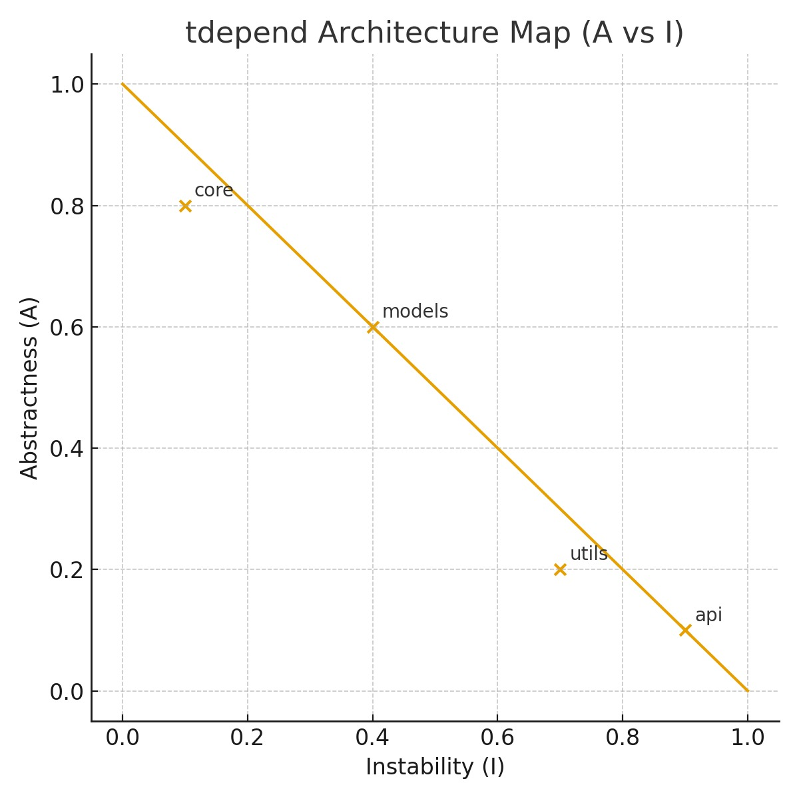

# Getting Started with tdepend

Welcome to tdepend, a powerful CLI tool and library for analyzing architectural fitness in TypeScript projects. This guide will help you get started quickly.

## Installation

Install tdepend globally for CLI usage:

```bash
npm install -g tdepend
# or
yarn global add tdepend
# or
pnpm add -g tdepend
```

Or install as a development dependency in your project:

```bash
npm install -D tdepend
# or
yarn add -D tdepend
# or
pnpm add -D tdepend
```

## Quick Start (CLI)

Run tdepend on your project:

```bash
tdepend analyze
```

This performs a complete analysis and outputs architectural metrics including:

- **Afferent Coupling (Ca)**: Number of modules that depend on this module
- **Efferent Coupling (Ce)**: Number of modules this module depends on
- **Instability (I)**: Ratio of efferent to total coupling
- **Abstractness (A)**: Ratio of abstract types to total types
- **Distance (D)**: Distance from the main sequence
- **Cycles**: Circular dependencies detected using Tarjan's algorithm

### CLI Commands & Options

```bash
# Basic analysis
tdepend analyze

# Use custom config file
tdepend analyze --config custom-config.json

# Export analysis to JSON file
tdepend analyze --export analysis-result.json
tdepend analyze -o analysis-result.json

# CI mode with JSON output and strict exit codes
tdepend analyze --ci

# Analyze specific class
tdepend analyze --class MyClassName

# Analyze specific namespace
tdepend analyze --namespace MyNamespace

# Analyze specific module/file
tdepend analyze src/services/user.ts
```

## Quick Start (Library)

Use tdepend programmatically in your Node.js/TypeScript applications:

```typescript
import { analyze, exportToFile } from 'tdepend';

// Run analysis with options
const result = await analyze({
  rootDir: 'src',
  include: ['src/**/*.ts'],
  failOnCycle: true
});

console.log(`Analyzed ${result.modules.length} modules`);
console.log(`Found ${result.cycles.length} cycles`);

// Export results to JSON
await exportToFile(result, 'architecture-snapshot.json');

// Access detailed metrics
for (const metric of result.metrics) {
  if (metric.distance > 0.8) {
    console.log(`${metric.filePath}: D=${metric.distance.toFixed(2)}`);
  }
}
```

### Library API

**Main Functions:**
- `analyze(options?)` - Run dependency analysis with custom options
- `analyzeWithConfig(config)` - Execute analysis using a full config object
- `exportToFile(result, filePath, options?)` - Write analysis results to JSON file
- `exportToJson(result, options?)` - Serialize analysis to JSON string
- `toSerializable(result)` - Transform result to serializable format

**Core Building Blocks:**
- `DependencyGraph` - Graph data structure for dependency relationships
- `detectCycles(graph)` - Detect circular dependencies
- `computeAllMetrics(graph, modules, cycles)` - Calculate architectural metrics
- `parseProject(files)` - Parse and extract TypeScript module information
- `scanFiles(config)` - Discover files matching glob patterns
- `loadConfig(path?)` - Load and validate configuration

## Configuration

Create a `tdepend.config.json` file in your project root:

```json
{
  "rootDir": "src",
  "include": ["src/**/*.ts", "src/**/*.tsx"],
  "exclude": ["**/*.test.ts", "**/*.spec.ts", "dist"],
  "metrics": {
    "enabled": ["coupling", "abstractness", "distance", "cycles"],
    "thresholds": {
      "distance": 0.6
    }
  },
  "analysis": {
    "target": null,
    "value": null
  },
  "ci": {
    "failOnThreshold": true,
    "failOnCycle": false,
    "outputFormat": "console"
  }
}
```

### Configuration Options

- **rootDir**: Root directory for analysis (default: `"src"`)
- **include**: Glob patterns for files to include (default: `["src/**/*.ts", "src/**/*.tsx"]`)
- **exclude**: Glob patterns for files to exclude (default: `["**/*.test.ts", "**/*.spec.ts", "dist"]`)
- **metrics.enabled**: Metrics to compute (`"coupling"`, `"abstractness"`, `"distance"`, `"cycles"`)
- **metrics.thresholds.distance**: Maximum allowed distance from main sequence (default: `0.6`)
- **analysis.target**: Scope analysis to `"module"`, `"class"`, or `"namespace"` (default: `null`)
- **analysis.value**: Value for the target scope
- **ci.failOnThreshold**: Exit with code 1 on threshold violations (default: `true`)
- **ci.failOnCycle**: Exit with code 1 when cycles are detected (default: `false`)
- **ci.outputFormat**: Output format - `"console"` or `"json"` (default: `"console"`)

## Understanding Metrics



### Instability (I)

Instability measures how susceptible a module is to change:

```
I = Ce / (Ca + Ce)
```

- **I = 0**: Maximally stable (many dependents, few dependencies)
- **I = 1**: Maximally unstable (few dependents, many dependencies)

### Abstractness (A)

Abstractness measures the ratio of abstract types to concrete types:

```
A = (Abstract Classes + Interfaces) / Total Types
```

- **A = 0**: Completely concrete
- **A = 1**: Completely abstract

### Distance from Main Sequence (D)

The main sequence represents the ideal balance between stability and abstractness:

```
D = |A + I - 1|
```

- **D = 0**: Perfect balance (on the main sequence)
- **D > 0.6**: Too far from ideal (potential design smell)

Modules in the **Zone of Pain** (high stability, low abstractness) or **Zone of Uselessness** (low stability, high abstractness) should be refactored.

## Detecting Cycles

tdepend automatically detects circular dependencies using Tarjan's strongly connected components algorithm:

```bash
tdepend analyze
```

Cycles are included in the analysis output. To fail the build when cycles are detected:

```bash
tdepend analyze --ci
```

With `failOnCycle: true` in your config, or:

```typescript
const result = await analyze({
  rootDir: 'src',
  failOnCycle: true
});
```

## Export Formats

### CLI Export

```bash
# Export full analysis with all data
tdepend analyze --export full-analysis.json
```

### Programmatic Export

```typescript
import { analyze, exportToFile, toSerializable } from 'tdepend';

const result = await analyze({ rootDir: 'src' });

// Export to file
await exportToFile(result, 'analysis.json');

// Or get JSON string
const json = exportToJson(result, { pretty: true });

// Or get serializable object for custom processing
const serialized = toSerializable(result);
```

The exported JSON includes:
- Format version and timestamp
- Full configuration used
- All parsed modules with imports/exports
- Serialized dependency graph (Sets → Arrays)
- Normalized cycles with unique IDs
- Complete metrics for all modules
- Analysis report with violations

## Integration with Other Tools

tdepend is designed to work alongside other architectural tools:

### With ts-arch

```typescript
import { analyze } from 'tdepend';

const result = await analyze({ rootDir: 'src' });

// Use dependency graph for ts-arch rules
const dependencies = result.modules.map(m => ({
  file: m.filePath,
  imports: m.imports,
}));

// Apply architectural rules...
```

### With CI/CD

```typescript
import { analyze, exportToFile } from 'tdepend';

const result = await analyze({
  rootDir: 'src',
  failOnCycle: true,
  failOnThreshold: true
});

await exportToFile(result, 'tdepend-report.json');

if (!result.report.success) {
  console.error('Architecture violations detected!');
  process.exit(1);
}
```

### With Custom Dashboards

```typescript
import { analyze } from 'tdepend';

const result = await analyze({ rootDir: 'src' });

const dashboard = {
  timestamp: new Date().toISOString(),
  summary: result.report.summary,
  avgDistance: result.metrics.reduce((sum, m) => sum + m.distance, 0) / result.metrics.length,
  topCoupled: result.metrics.sort((a, b) => (b.Ce + b.Ca) - (a.Ce + a.Ca)).slice(0, 10)
};

// Send to your monitoring system...
```

## Example Output

### Console Output

```
📊 Summary:
  Total imports: 51
  Total exports: 70
  Total classes: 1
  Total interfaces: 15
  Cycles detected: 0

📥 Top modules by Ca (Afferent Coupling):
  - schema.ts: Ca=7, Ce=0
  - dependencyGraph.ts: Ca=6, Ce=2
  - parser.ts: Ca=6, Ce=0

📏 Modules by Distance from Main Sequence:
  - index.ts: D=1.00, A=0.00, I=0.00 (Zone of Pain)
  - schema.ts: D=1.00, A=0.00, I=0.00 (Zone of Pain)
```

### JSON Output

```json
{
  "version": "1.0.0",
  "timestamp": "2026-02-08T15:17:26.494Z",
  "config": { ... },
  "modules": [ ... ],
  "graph": {
    "nodes": [
      {
        "filePath": "/path/to/file.ts",
        "dependencies": ["..."],
        "dependents": ["..."]
      }
    ]
  },
  "cycles": [],
  "metrics": [ ... ],
  "report": {
    "success": true,
    "summary": { ... },
    "violations": { ... }
  }
}
```

## Next Steps

- Check out the [Concepts](/concepts) page to learn about architectural principles
- Browse the [examples](https://github.com/dvmhmdsd/tdepend/tree/main/examples) for integration patterns
- Set up quality gates in your CI/CD pipeline
- Integrate with ts-arch or dependency-cruiser for comprehensive checks
